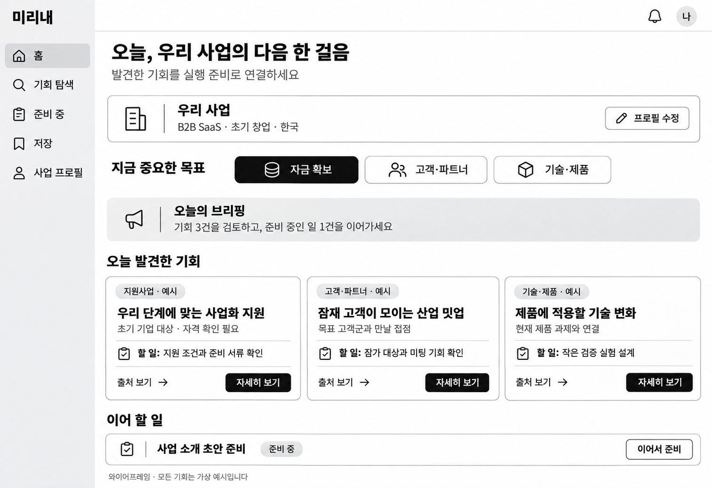
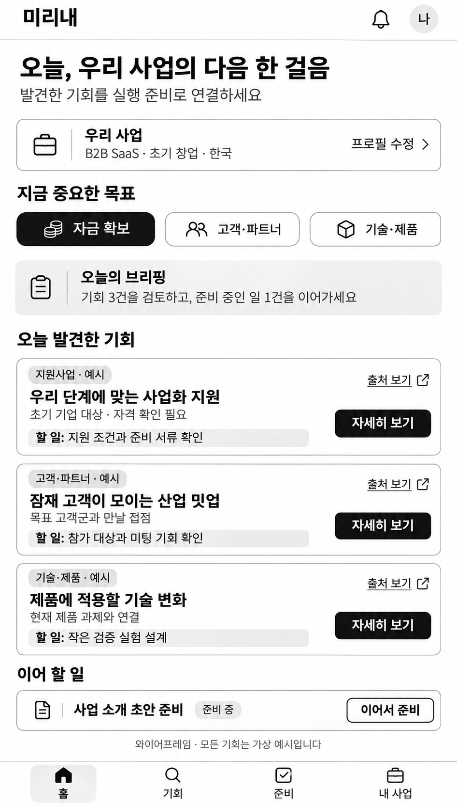

# 미리내 메인 홈 와이어프레임 v1

2026-11-13, HJ 요청에 따른 검토용 이미지. 확정된 기획이나 구현 결과가 아니다.

- [PC 웹 원본](desktop.png)
- [모바일 원본](mobile.png)
- [생성 프롬프트](PROMPTS.md)

## 화면 의도

카드 상세 패널을 닫은 상태의 메인 홈이다. 사업 프로필 → 현재 목표 → 오늘 브리핑 → 발견한 기회 → 이어 할 일 순으로 구성했다.

세 가설 페르소나는 자금 확보, 고객·파트너, 기술·제품이라는 목표로 표현한다. 선택한 목표는 기회 우선순위를 나타내며 다른 범주의 기회도 함께 보여준다. 목표 선택의 실제 동작은 PM 검토 후 확정한다.

PC는 왼쪽 메뉴와 기회 카드 3열, 모바일은 단일 열과 하단 탐색 메뉴다. 모바일 이미지는 스크롤 영역 전체를 펼친 것으로 한 번에 모두 보이는 실제 기기 화면을 뜻하지 않는다.

모든 사업 프로필, 프로그램, 행사, 카드 수와 진행 상태는 가상 예시다. 인터뷰 대상의 자율주행 사업 배경은 사용하지 않았다. 상세 패널·팝업·원문 내용은 이 이미지 범위에 포함하지 않았다.

## 생성과 검토

기본 제공 image_gen 도구로 각각 새로 생성한 PNG다. 생성 뒤 두 이미지에서 한글 라벨, 카드 3종, 전체 배치, 상세 패널이 없는 메인 화면인지 확인했다. 클릭 가능한 프로토타입과 제품 코드는 만들지 않았다.

Discord에서 생성 도구의 인라인 이미지가 보이지 않을 수 있어, 원본 PNG를 Git 브랜치로 공유한다. main과 기획서는 이 초안 때문에 변경하지 않는다.

