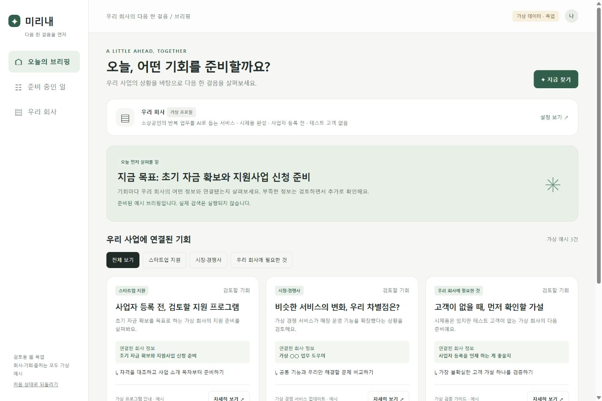
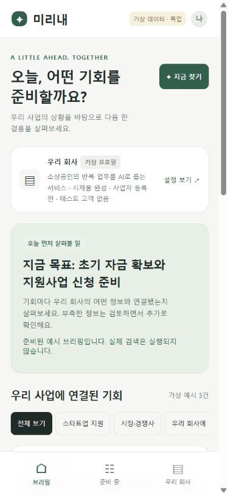

# 미리내 간단한 웹 목업

HJ의 2026-11-13 요청과 소라가 정리한 [MVP.md](../MVP.md)를 기준으로 한 클릭 가능한 초안이다. 기획 확정이나 실제 에이전트 구현을 뜻하지 않는다.

## 열기

설치 없이 `interactive.html`을 브라우저에서 열 수 있다. 로컬 서버를 사용하려면 저장소 루트에서 다음을 실행한다(Node.js 필요, 새 패키지 설치 없음).

```powershell
node docs/product/mockup/serve.cjs
```

주소: http://127.0.0.1:3107

포트가 사용 중이면 `node docs/product/mockup/serve.cjs 3108`처럼 다른 포트를 지정한다. HTML 파일 URL과 서버 URL의 브라우저 저장소는 서로 다르다.

공유 주소는 https://stynerk.github.io/onemorestep/ 이다. HJ가 2026-11-13 공개 접속 URL 구성을 요청했다. GitHub Pages의 `gh-pages` 브랜치 루트에서 목업만 제공한다. 실제 API 호출은 하지 않는다.

### 회사 자료 가져오기

`회사 자료` 메뉴에서 회사 프로필과 참고 자료, 업무 이력을 함께 확인한다.

- 메모 붙여넣기: 제목과 본문을 검토한 뒤 반영한다.
- PC 파일·폴더: 선택한 UTF-8 TXT/MD를 한 번 읽어 미리보기로 가져온다. 파일당 32KB/본문 8,000자, 전체 30개까지이며 지원하지 않는 파일은 제외한다. 폴더 지정은 브라우저 지원 여부에 따라 달라진다.
- Notion·Google Drive·웹 링크: 출처 링크와 복사한 본문을 등록한다. 계정 연결이나 URL 본문 자동 수집은 구현하지 않았다.
- 자료마다 사실/가설, 자료 종류, 연결할 테마를 선택한다. 상세 화면에서 출처와 원문을 펼쳐 볼 수 있고 새 초안에는 해당 테마 자료 최대 3개의 앞 500자를 원문 발췌로 덧붙인다. 자동 분석·추론 결과가 아니다.
- 수정·삭제·새로고침 후 유지가 가능하다. 기존에 저장한 초안은 덮어쓰지 않으므로 자료 변경·삭제 후 기존 발췌는 직접 수정한다.

공유한 Discord 메시지에서 연결된 Claude 기획 대화의 채널 선택 → 자료 미리보기 → 사용자 확인 후 반영 흐름을 참고했다. 해당 비공개 대화 내용·파일·인증정보를 사이트에 복제하지 않았다.

### 배포 파일 준비

```powershell
node docs/product/mockup/build-pages.cjs
```

`.cache/mirinae-pages`에 `index.html`, `knowledge.js`, `.nojekyll`만 생성한다. 검토 후 HJ가 승인한 배포 작업에서 이 파일들만 `gh-pages` 브랜치에 올린다. 이 명령 자체는 배포하지 않는다. 소라의 원본 초안 `index.html` 대신 검증 버전 `interactive.html`을 사이트 첫 화면으로 복사한다.

## 눌러볼 흐름

1. **설정 보기 / 우리 회사**: 6개 질문을 수정하고 사실·가설을 선택해 저장한다.
2. **지금 찾기**: 외부 검색 없이 준비된 예시 브리핑을 표시한다.
3. **테마 선택**: 스타트업 지원, 시장·경쟁사, 우리 회사에 필요한 것 중 선택한다.
4. **자세히 보기**: 연결된 회사 정보, 가상 출처, 체크리스트와 편집 가능한 초안을 확인한다.
5. **지역 답변 반영**: 서울/다른 지역에 따라 가상 조건 대조와 브리핑 안내가 달라진다. 실제 자격 판정은 아니다.
6. **초안 저장 / 준비 시작**: 내용을 저장하고 준비 목록에서 이어 본다. 체크, 완료, 보류 상태도 저장된다.
7. **목업 데이터 초기화**: 확인 후 가상 체험 데이터만 처음 상태로 되돌린다.

입력과 상태는 이 브라우저의 localStorage에만 저장한다. 저장이 제한되면 현재 화면의 메모리 상태로 체험한다. 외부로 전송하지 않는다. DOM 출력 시 입력 문자열은 HTML로 실행되지 않도록 이스케이프한다.

## 검증

2026-11-13 Chrome에서 실제 클릭으로 확인했다.

- 회사 목표 수정과 브리핑 반영, 사실/가설 표시.
- 테마별 필터와 빈 상태.
- 상세 화면의 되묻기, 지역 입력 반영.
- 체크리스트, 초안 수정·저장, 준비 목록 이동, 완료·보류 처리.
- 새로고침 후 수정한 목표·지역·체크 상태·초안 유지.
- 데이터 초기화 후 최초 상태 복구.
- PC 1440px, 모바일 390px과 모바일 상세 모달의 가로 넘침 없음.
- 실제 HTTP 200, JavaScript 구문 검사 통과.
- 회사 자료 등록·수정·삭제, 사실/가설·테마 연결, 새로고침 후 유지, 상세 및 새 초안 원문 발췌를 확인했다.
- HTML 입력의 문자열 출력과 javascript: 링크 차단, 390px 자료실 및 미리보기 가로 넘침 없음.
- 파일 선택창은 열었으나 파일 전달은 브라우저 자동 승인 검토가 거절했다. PC 파일·폴더 가져오기는 구현했지만 실제 파일 선택부터 반영까지의 브라우저 검증을 완료하지 못했다. 이를 우회하지 않았다.

실제 Liner/LLM, 서버 DB, 로그인, 정시 실행, 외부 신청·연락은 구현하지 않았다. 기회 데이터는 고정 예시이며 회사 입력 변경 시 실제 추천·재검색을 수행하지 않는다. 초안은 템플릿에 입력값을 넣은 결과다. 목업 데이터로 대회 API 활용 조건이나 사용자 가치를 검증했다고 판정하지 않는다.

## 화면

[PC 미리보기](desktop-preview.png) · [모바일 미리보기](mobile-preview.png)

[회사 자료실 PC](knowledge-desktop.jpg) · [회사 자료실 모바일](knowledge-mobile.jpg)





소라가 먼저 남긴 참고용 초안 `index.html`(daa37ab)은 원문 그대로 보존했다. 클릭·반응형·저장 검증을 진행한 이 문서의 대상은 `interactive.html`이며, 로컬 서버의 기본 화면도 이 파일이다. 기획의 최종 정리와 선택은 소라가 맡는다.
